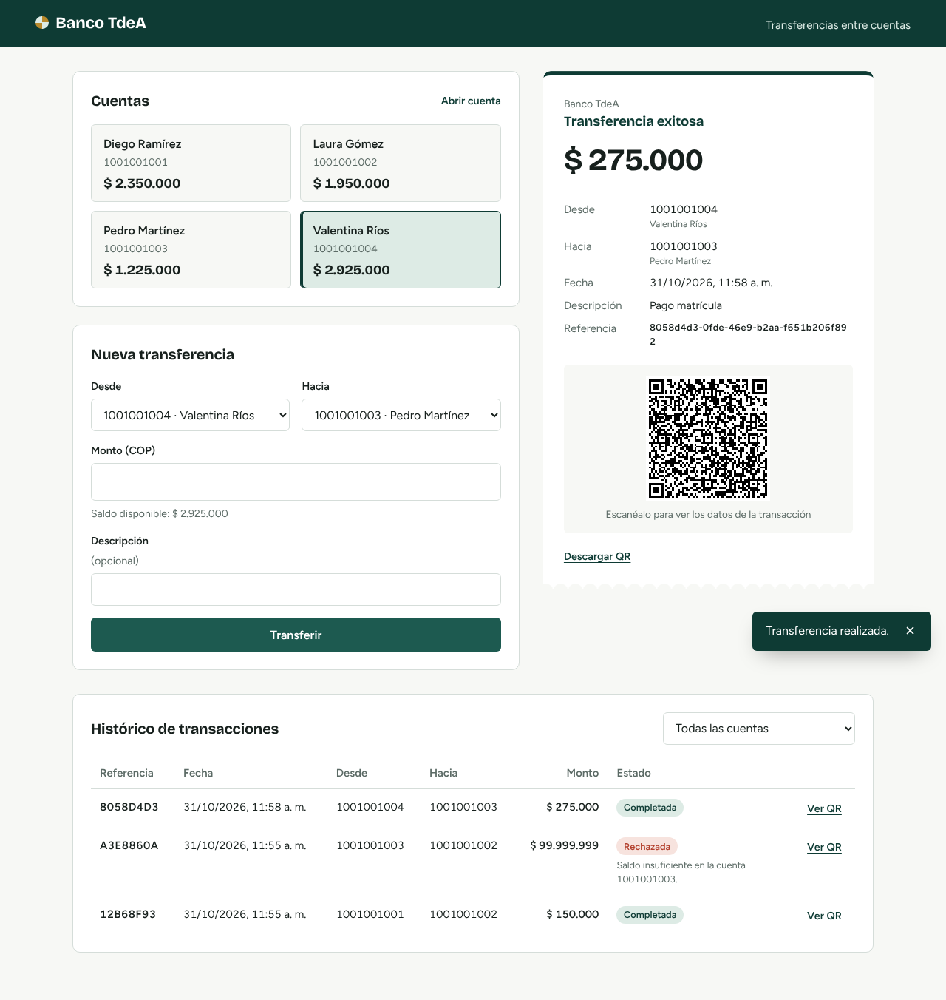
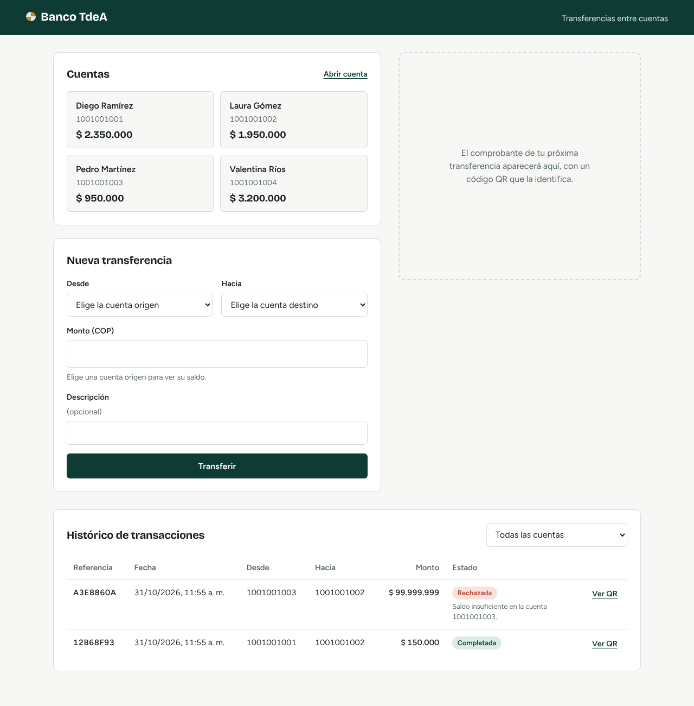
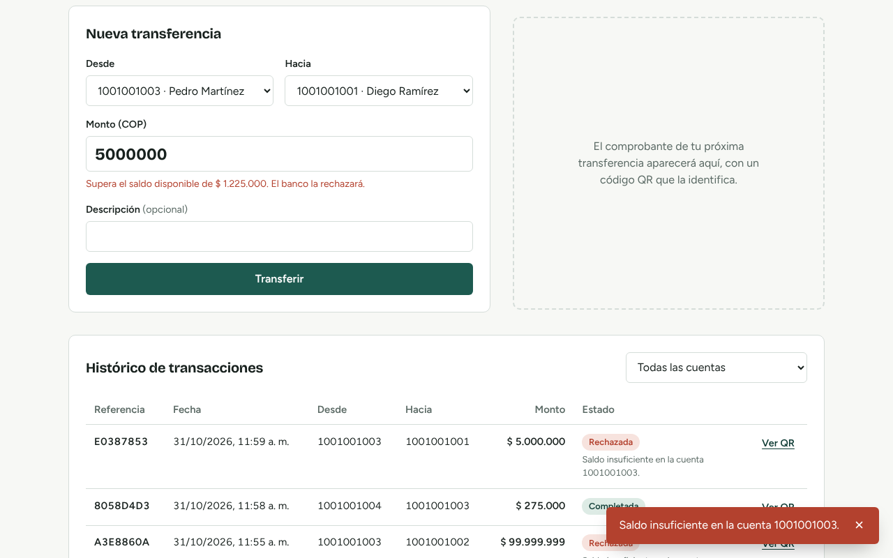
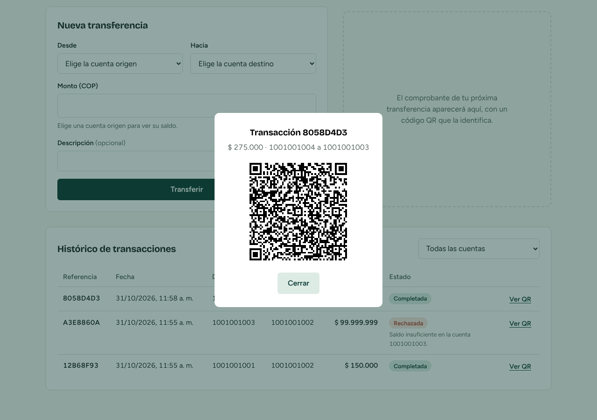
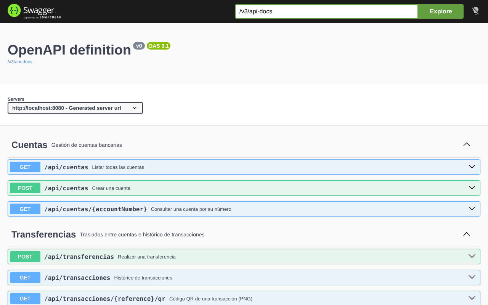

# Banco TdeA — Transferencias entre cuentas

Aplicación full stack para trasladar dinero entre cuentas bancarias. Muestra el histórico de transacciones y, al completar cada transferencia, genera un **código QR** con los datos básicos de la transacción.

Ejercicio propuesto del *Laboratorio Spring Boot con Cursor* — Tecnológico de Antioquia, 2026.



## Funcionalidades

- Listar cuentas con su saldo y abrir cuentas nuevas.
- Transferir dinero entre dos cuentas con validación de reglas de negocio:
  - las cuentas deben existir,
  - origen y destino deben ser distintas,
  - el monto debe ser mayor que cero,
  - la cuenta origen debe tener saldo suficiente.
- Comprobante con código QR (referencia, cuentas, monto, fecha y estado), descargable como PNG.
- Histórico de transacciones (completadas y rechazadas) con filtro por cuenta y QR de cada movimiento.
- Mensajes de error tipo *toast* con el detalle que devuelve el backend.
- Documentación interactiva de la API con Swagger.

## Stack tecnológico

| Capa | Tecnología |
|---|---|
| Backend | Java 21+ (compatible con Java 25), Spring Boot 4.0.9, Spring Web MVC, Spring Data JPA / Hibernate, Bean Validation |
| Base de datos | PostgreSQL (H2 en memoria para las pruebas) |
| QR | ZXing 3.5.4 |
| Documentación API | springdoc-openapi 3 (Swagger UI) |
| Frontend | React 19, Vite 6, Axios |
| IDE | Cursor (reglas en `.cursor/rules/springboot.mdc`) |

## Arquitectura

Arquitectura en capas en el backend y SPA en el frontend:

```
React (localhost:3000)
   │  Axios + VITE_API_URL
   ▼
Controller  ── valida (@Valid) y elige el código HTTP
   ▼
Service     ── reglas de negocio, transacciones, generación del QR
   ▼
Repository  ── Spring Data JPA (bloqueo PESSIMISTIC_WRITE en las cuentas)
   ▼
PostgreSQL  ── tablas accounts y transactions
```

Decisiones de diseño relevantes:

- **Dinero con `BigDecimal`** (precisión 19, escala 2), nunca `double`.
- **Atomicidad**: débito, crédito y registro de la transacción ocurren en una sola transacción de base de datos. Las dos cuentas se bloquean siempre en el mismo orden para evitar *deadlocks* entre transferencias cruzadas.
- **Histórico completo**: si una regla falla, se hace *rollback* y el intento se guarda aparte con estado `REJECTED` y su motivo.
- **Errores estándar**: las excepciones de negocio forman una jerarquía `sealed` y se devuelven como `ProblemDetail` (RFC 9457).
- **DTOs como `record`** de Java; las entidades no salen de la capa de servicio.

### Estructura

```
BancoTransferencias-TdeA/
├── .cursor/rules/springboot.mdc   Reglas de Cursor
├── backend/                       API Spring Boot
│   └── src/main/java/com/tdea/banktransfer/
│       ├── config/       CORS y datos de ejemplo
│       ├── controller/   Endpoints REST
│       ├── dto/          Records de entrada y salida
│       ├── entity/       Account, Transaction, TransactionStatus
│       ├── exception/    Excepciones de negocio y manejador global
│       ├── repository/   Repositorios JPA
│       └── service/      Cuentas, transferencias y QR
├── frontend/                      SPA React + Vite
└── docs/                          Informe, prompts y capturas
```

## API REST

Base: `http://localhost:8080/api`

| Método | Ruta | Descripción | Respuestas |
|---|---|---|---|
| GET | `/cuentas` | Lista todas las cuentas | 200 |
| GET | `/cuentas/{numero}` | Consulta una cuenta | 200, 404 |
| POST | `/cuentas` | Abre una cuenta | 201, 400, 409 |
| POST | `/transferencias` | Transfiere dinero y devuelve el QR | 201, 400, 404, 422 |
| GET | `/transacciones?cuenta={numero}` | Histórico (filtro opcional) | 200 |
| GET | `/transacciones/{referencia}/qr` | Imagen PNG del QR | 200, 400 |

Ejemplo de transferencia:

```bash
curl -X POST http://localhost:8080/api/transferencias \
  -H "Content-Type: application/json" \
  -d '{"sourceAccount":"1001001001","targetAccount":"1001001002","amount":150000,"description":"Pago arriendo"}'
```

Respuesta (resumida):

```json
{
  "transaction": {
    "reference": "12b68f93-f37f-44c0-8caf-cf0ed2056306",
    "sourceAccount": "1001001001",
    "targetAccount": "1001001002",
    "amount": 150000,
    "status": "COMPLETED",
    "createdAt": "2026-10-31T11:55:13"
  },
  "qrCode": "data:image/png;base64,iVBORw0KGgo...",
  "qrContent": "BANCO TdeA - Comprobante de transferencia\nReferencia: ..."
}
```

## Cómo ejecutarlo

### Requisitos

- JDK 21 o superior (el laboratorio usa JDK 25)
- Maven 3.9+ (o el que trae IntelliJ / Cursor)
- Node.js 20+ (el laboratorio usa Node 24)
- Docker Desktop (para PostgreSQL) o nada si usas el perfil H2

### 1. Base de datos

No necesitas pgAdmin (es solo un visor). Elige una de estas opciones:

**Opción A — PostgreSQL con Docker (recomendada).** Abre Docker Desktop y, en la carpeta raíz del proyecto, ejecuta:

```bash
docker compose up -d
```

Esto descarga PostgreSQL 16 y crea la base de datos `banktdea` con usuario `postgres` y contraseña `root`. Para detenerla: `docker compose down` (los datos se conservan).

**Opción B — Sin instalar nada (H2 en memoria).** Arranca el backend con el perfil `h2`:

```bash
cd backend
mvn spring-boot:run -Dspring-boot.run.profiles=h2
```

Los datos se borran al detener la aplicación, así que sirve para probar rápido.

**Opción C — PostgreSQL instalado en Windows.** Si ya lo tienes, crea la base con `psql -U postgres -c "CREATE DATABASE banktdea;"`. Si tu usuario o contraseña son distintos, edita `backend/src/main/resources/application.properties` o define las variables `DB_URL`, `DB_USER` y `DB_PASSWORD`.

### 2. Backend

```bash
cd backend
mvn spring-boot:run
```

Al iniciar por primera vez se crean las tablas y cuatro cuentas de ejemplo. Swagger queda en <http://localhost:8080/swagger-ui.html>.

Pruebas:

```bash
mvn test
```

### 3. Frontend

```bash
cd frontend
npm install
npm run dev
```

Abre <http://localhost:3000>. La URL del backend se configura en `frontend/.env` (`VITE_API_URL`).

## Capturas

| | |
|---|---|
|  |  |
|  |  |

## Documentación adicional

- `docs/PROMPTS.md` — prompts usados en Cursor para generar cada capa.
- `docs/Informe_Transferencias_Bancarias.docx` — informe del ejercicio.
